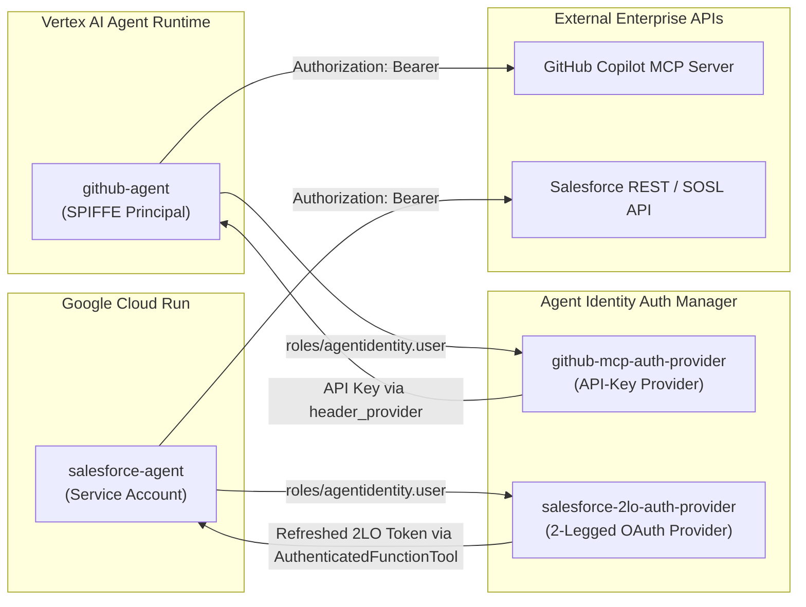

# Agent Identity Foundations & Auth Manager (`2_agent-identity-foundation`)

Complete reference implementation, starter baseline, deployment automation, and production runbook for **Google Cloud Agent Identity** and **Agent Identity Auth Manager** with the **Agent Development Kit (ADK)** (**APEX013: [FDE] Agent Identity Foundations**).

---

## Overview

In enterprise multi-agent architectures, embedding third-party credentials (such as GitHub Personal Access Tokens or Salesforce Connected App client secrets) in `.env` files or container environment variables creates a significant security and operational burden.

This repository demonstrates how to eliminate hardcoded tool secrets across two different Google Cloud agent runtimes using **Agent Identity** and **Agent Identity Auth Manager**:

1. **`github-agent` (Vertex AI Agent Runtime + SPIFFE Agent Identity)**:
   - Provisioned with a Google-managed **SPIFFE principal** (`principal://agents.global.org-<ORG_ID>.system.id.goog/resources/aiplatform/projects/<PROJECT_NUMBER>/locations/<REGION>/reasoningEngines/<ENGINE_ID>`).
   - Authenticates to an **API-Key Auth Provider** (`github-mcp-auth-provider`) at tool-call time and injects the token into outbound MCP requests via an ADK `header_provider`.
2. **`salesforce-agent` (Cloud Run + Service Account Identity)**:
   - Authenticates via Application Default Credentials (ADC) using its **Cloud Run Service Account** (`serviceAccount:<SA_EMAIL>`).
   - Resolves fresh OAuth 2.0 access tokens from a **2-Legged OAuth (2LO) Auth Provider** (`salesforce-2lo-auth-provider`) via ADK's `AuthenticatedFunctionTool`, which injects an `AuthCredential` directly into the Python tool function.



---

## Repository Structure

```text
2_agent-identity-foundation/
├── README.md                          # Architecture overview & quickstart
├── RUNBOOK.md                         # End-to-end production deployment & Day-2 operations runbook
├── LAB_MANUAL.md                      # Complete APEX013 Challenge Lab instructions & solved tasks
├── scripts/
│   └── deploy_production.sh           # Automated end-to-end deployment script for production/lab
├── apex_labs/
│   └── lab2_prereqs.sh                # Lab 2 prerequisite environment bootstrapper
├── agents/                            # PRODUCTION SOLUTION (Refactored for Agent Identity & Auth Manager)
│   ├── github-agent/                  # Vertex AI Agent Runtime agent (MCP + GcpAuthProviderScheme)
│   │   ├── .env.example
│   │   ├── Dockerfile
│   │   ├── deploy_with_identity.sh    # Two-phase SPIFFE identity + source deployment script
│   │   └── agent/
│   │       ├── agent.py               # Refactored McpToolset + github_header_provider
│   │       ├── main.py                # Dynamic A2A FastAPI entrypoint
│   │       └── requirements.txt
│   └── salesforce-agent/              # Cloud Run agent (AuthenticatedFunctionTool + 2LO Auth Provider)
│       ├── .env.example
│       ├── Dockerfile
│       ├── agents-cli-manifest.yaml
│       ├── pyproject.toml             # Includes google-adk[gcp,agent-identity]
│       ├── uv.lock
│       ├── app/
│       │   ├── agent.py               # Credential-free SalesforceClient wiring
│       │   ├── salesforce_client.py   # SOSL search & document excerpt client (no secrets)
│       │   ├── tools.py               # AuthenticatedFunctionTool + _extract_token(credential)
│       │   ├── fast_api_app.py
│       │   └── app_utils/
│       ├── deployment/terraform/      # Single-project Terraform definitions
│       ├── scripts/
│       └── tests/
└── starter/                           # STARTER BASELINE (Pre-refactoring Lab 1 state with .env secrets)
    ├── github-agent/
    └── salesforce-agent/
```

---

## Quickstart

### Option A: Automated End-to-End Deployment

Run the interactive production deployment script to enable APIs, create both Auth Providers in Agent Identity Auth Manager, deploy both agents (`github-agent` to Vertex AI Agent Runtime with SPIFFE identity and `salesforce-agent` to Cloud Run), bind least-privilege IAM policies, and run end-to-end A2A verification tests:

```bash
chmod +x scripts/deploy_production.sh
./scripts/deploy_production.sh
```

### Option B: Step-by-Step Production Runbook

Follow [**`RUNBOOK.md`**](RUNBOOK.md) for the complete, step-by-step production implementation guide, including:
- Least-privilege IAM matrix for SPIFFE principals and Cloud Run service accounts
- Creating API-key and 2-Legged OAuth (2LO) Auth Providers
- Two-phase Reasoning Engine deployment for SPIFFE Agent Identity
- Zero-downtime credential rotation and emergency IAM revocation
- Production troubleshooting guide

### Option C: Challenge Lab Walkthrough

Follow [**`LAB_MANUAL.md`**](LAB_MANUAL.md) for the exact step-by-step solution to **[FDE] Agent Identity Foundations: Challenge Lab (APEX013)**.
