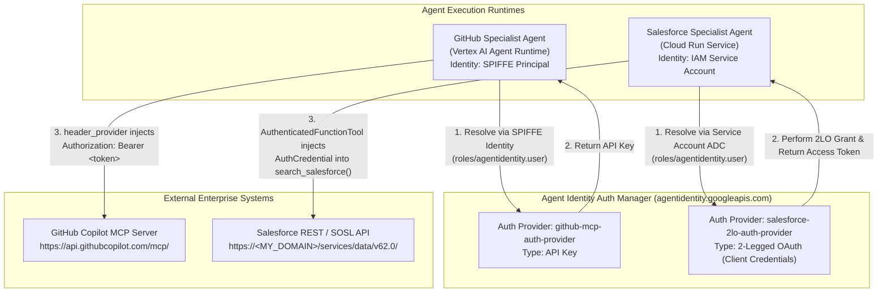

# Production Runbook: Agent Identity Foundations & Auth Manager

> [!IMPORTANT]
> This runbook provides a complete, production-ready guide for eliminating hardcoded credentials in multi-agent systems using **Google Cloud Agent Identity** and **Agent Identity Auth Manager** with the **Agent Development Kit (ADK)**. Following this runbook end-to-end enables you to deploy, secure, verify, rotate, and operate both Agent Runtime (SPIFFE) and Cloud Run (Service Account) specialist agents in production.

---

## Table of Contents

1. [Executive Summary & Architecture](#1-executive-summary--architecture)
2. [Production Prerequisites & IAM Matrix](#2-production-prerequisites--iam-matrix)
3. [Step-by-Step Production Deployment Guide](#3-step-by-step-production-deployment-guide)
   - [Step 1: Initialize Environment & Baseline APIs](#step-1-initialize-environment--baseline-apis)
   - [Step 2: Provision Auth Providers in Agent Identity Auth Manager](#step-2-provision-auth-providers-in-agent-identity-auth-manager)
   - [Step 3: Deploy GitHub Specialist Agent (Vertex AI Agent Runtime + SPIFFE)](#step-3-deploy-github-specialist-agent-vertex-ai-agent-runtime--spiffe)
   - [Step 4: Deploy Salesforce Specialist Agent (Cloud Run + Service Account)](#step-4-deploy-salesforce-specialist-agent-cloud-run--service-account)
4. [Code Refactoring Reference (Before vs. After)](#4-code-refactoring-reference-before-vs-after)
5. [Day-2 Production Operations](#5-day-2-production-operations)
   - [Zero-Downtime Credential Rotation](#51-zero-downtime-credential-rotation)
   - [Immediate Access Revocation](#52-immediate-access-revocation)
   - [Auditing & Verification](#53-auditing--verification)
   - [Troubleshooting Guide](#54-troubleshooting-guide)

---

## 1. Executive Summary & Architecture

Hardcoded credentials in `.env` files or container images introduce severe operational and security risks: secrets travel with deployments, are visible to anyone who can inspect container configuration, and require redeploying every dependent agent during rotation.

By combining **Agent Identity** (*who the agent is*) with **Agent Identity Auth Manager** (*what credentials the agent is authorized to read*), agents authenticate using their own Google-managed cryptographic identity at tool-call time:

1. **Agent Identity**:
   - **Vertex AI Agent Runtime (`github-agent`)**: Provisioned with `identityType: AGENT_IDENTITY` and assigned a dedicated **SPIFFE principal**:
     ```text
     principal://agents.global.org-<ORGANIZATION_ID>.system.id.goog/resources/aiplatform/projects/<PROJECT_NUMBER>/locations/<REGION>/reasoningEngines/<ENGINE_ID>
     ```
   - **Cloud Run (`salesforce-agent`)**: Authenticates via Application Default Credentials (ADC) using its dedicated **Cloud Run Service Account**:
     ```text
     serviceAccount:<SERVICE_ACCOUNT_EMAIL>
     ```
2. **Agent Identity Auth Manager**:
   - Stores external credentials centrally in Google-managed **Auth Providers**:
     - **API-Key Auth Provider** (`github-mcp-auth-provider`) for static bearer tokens / API keys.
     - **2-Legged OAuth (2LO) Auth Provider** (`salesforce-2lo-auth-provider`) for OAuth 2.0 `client_credentials` flows, automatically exchanging and refreshing tokens.
   - Enforces fine-grained IAM (`roles/agentidentity.user`) per Auth Provider.
3. **ADK Runtime Resolution**:
   - **MCP Tools (`McpToolset`)**: Uses `GcpAuthProviderScheme` + `header_provider` to intercept outbound MCP HTTP requests and inject `Authorization: Bearer <token>`.
   - **Function Tools (`AuthenticatedFunctionTool`)**: Uses `AuthConfig(auth_scheme=GcpAuthProviderScheme(...))` to inject an `AuthCredential` object directly into the Python tool function's `credential` argument at call time.



---

## 2. Production Prerequisites & IAM Matrix

### 2.1 Tooling Prerequisites

- **Google Cloud SDK (`gcloud`)** with `alpha` and `beta` components installed
- **Python 3.11 – 3.13**
- **`uv`** (`curl -LsSf https://astral.sh/uv/install.sh | sh`)
- **`google-agents-cli`** (`uv tool install "google-agents-cli==1.0.0" --force`)
- **`jq`** for JSON parsing in shell commands

### 2.2 Required Google Cloud APIs

```bash
gcloud services enable \
  iam.googleapis.com \
  iamcredentials.googleapis.com \
  sts.googleapis.com \
  agentidentity.googleapis.com \
  agentidentitycredentials.googleapis.com \
  aiplatform.googleapis.com \
  run.googleapis.com \
  cloudbuild.googleapis.com \
  artifactregistry.googleapis.com \
  logging.googleapis.com \
  cloudtrace.googleapis.com \
  --project="${PROJECT_ID}"
```

### 2.3 Least-Privilege IAM Matrix

| Principal | Resource Scope | Required IAM Roles | Purpose |
| :--- | :--- | :--- | :--- |
| **Platform Admin / CI Pipeline** | Project | `roles/agentidentity.admin`<br/>`roles/resourcemanager.projectIamAdmin`<br/>`roles/aiplatform.admin`<br/>`roles/run.admin` | Create Auth Providers, deploy agents, bind IAM policies |
| **Reasoning Engine Service Agent**<br/>`service-<PROJECT_NUMBER>@gcp-sa-aiplatform-re.iam.gserviceaccount.com` | Project | `roles/aiplatform.user`<br/>`roles/logging.logWriter`<br/>`roles/cloudtrace.agent` | Allow Vertex AI Agent Runtime control plane to start reasoning engines and emit telemetry |
| **GitHub Agent SPIFFE Principal**<br/>`principal://agents.global.org-<ORG_ID>.system.id.goog/.../reasoningEngines/<ENGINE_ID>` | Project | `roles/aiplatform.user`<br/>`roles/serviceusage.serviceUsageConsumer`<br/>`roles/logging.logWriter`<br/>`roles/monitoring.metricWriter`<br/>`roles/cloudtrace.agent` | Invoke Gemini models, call Google APIs (Service Usage check), and write logs/traces |
| **GitHub Agent SPIFFE Principal** | Auth Provider (`github-mcp-auth-provider`) | `roles/agentidentity.user` | Fetch the GitHub API key at tool-call time |
| **Salesforce Agent Service Account**<br/>`serviceAccount:<SF_SA>` | Project | `roles/aiplatform.user`<br/>`roles/serviceusage.serviceUsageConsumer`<br/>`roles/logging.logWriter`<br/>`roles/cloudtrace.agent` | Invoke Gemini models, pass Service Usage check when calling Auth Manager API, and write logs/traces |
| **Salesforce Agent Service Account** | Auth Provider (`salesforce-2lo-auth-provider`) | `roles/agentidentity.user` | Fetch refreshed 2LO Salesforce access tokens at tool-call time |

### 2.4 External Platform Prerequisites

1. **GitHub**:
   - Personal Access Token (classic) with `repo` and `read:org` scopes (or fine-grained token with repository/issue read permissions).
2. **Salesforce**:
   - **My Domain URL**: e.g., `your-org.develop.my.salesforce.com` (without `https://`).
   - **Connected App / External Client App**:
     - Enable OAuth Settings (`Access the identity URL service`, `Manage user data via APIs (api)`).
     - Enable **Client Credentials Flow** (`Enable Client Credentials Flow`).
     - In **Manage Connected Apps -> Edit Policies -> Client Credentials Flow -> Run As**, assign a dedicated integration user who has read permissions on **Salesforce Files** (`Query All Files` / Library membership).
     - Record the **Consumer Key** (`SF_CLIENT_ID`) and **Consumer Secret** (`SF_CLIENT_SECRET`).

---

## 3. Step-by-Step Production Deployment Guide

### Step 1: Initialize Environment & Baseline APIs

```bash
export PROJECT_ID="your-gcp-project-id"
export LOCATION="us-central1"
export REGION="us-central1"

gcloud config set project "${PROJECT_ID}"

export PROJECT_NUMBER=$(gcloud projects describe "${PROJECT_ID}" --format='value(projectNumber)')
export ORGANIZATION_ID=$(gcloud projects get-ancestors "${PROJECT_ID}" --format=json | jq -r '.[] | select(.type=="organization") | .id')

echo "Project: ${PROJECT_ID} (${PROJECT_NUMBER}), Org: ${ORGANIZATION_ID}, Location: ${LOCATION}, Region: ${REGION}"
```

Enable the required Google Cloud APIs and ensure the Vertex AI Reasoning Engine service agent exists with baseline permissions:

```bash
gcloud services enable \
  iam.googleapis.com \
  agentidentity.googleapis.com \
  aiplatform.googleapis.com \
  agentidentitycredentials.googleapis.com \
  iamcredentials.googleapis.com \
  sts.googleapis.com \
  run.googleapis.com \
  cloudbuild.googleapis.com \
  artifactregistry.googleapis.com \
  logging.googleapis.com \
  cloudtrace.googleapis.com \
  --project="${PROJECT_ID}"

gcloud beta services identity create --service=aiplatform.googleapis.com --project="${PROJECT_ID}" || true

RE_SA="service-${PROJECT_NUMBER}@gcp-sa-aiplatform-re.iam.gserviceaccount.com"
for ROLE in roles/aiplatform.user roles/logging.logWriter roles/cloudtrace.agent; do
  gcloud projects add-iam-policy-binding "${PROJECT_ID}" \
    --member="serviceAccount:${RE_SA}" \
    --role="${ROLE}" \
    --condition=None
done
```

---

### Step 2: Provision Auth Providers in Agent Identity Auth Manager

#### 2.1 Create the GitHub API-Key Auth Provider

```bash
# Enter your GitHub PAT securely (does not echo to terminal or history)
read -rs GITHUB_PAT && echo

gcloud alpha agent-identity auth-providers create github-mcp-auth-provider \
  --project="${PROJECT_ID}" \
  --location="${LOCATION}" \
  --api-key="${GITHUB_PAT}"

unset GITHUB_PAT

# Verify the auth provider state is ENABLED
gcloud alpha agent-identity auth-providers list \
  --project="${PROJECT_ID}" \
  --location="${LOCATION}"

export GITHUB_AUTH_PROVIDER_URI="projects/${PROJECT_ID}/locations/${LOCATION}/authProviders/github-mcp-auth-provider"
echo "${GITHUB_AUTH_PROVIDER_URI}"
```

#### 2.2 Create the Salesforce 2-Legged OAuth (2LO) Auth Provider

```bash
export SF_DOMAIN="your-org.develop.my.salesforce.com"
export SF_CLIENT_ID="your-connected-app-consumer-key"
read -rs SF_CLIENT_SECRET && echo

gcloud alpha agent-identity auth-providers create salesforce-2lo-auth-provider \
  --project="${PROJECT_ID}" \
  --location="${LOCATION}" \
  --two-legged-oauth-client-id="${SF_CLIENT_ID}" \
  --two-legged-oauth-client-secret="${SF_CLIENT_SECRET}" \
  --two-legged-oauth-token-endpoint="https://${SF_DOMAIN}/services/oauth2/token"

unset SF_CLIENT_SECRET

# Verify both auth providers are ENABLED
gcloud alpha agent-identity auth-providers list \
  --project="${PROJECT_ID}" \
  --location="${LOCATION}"

export SALESFORCE_AUTH_PROVIDER_URI="projects/${PROJECT_ID}/locations/${LOCATION}/authProviders/salesforce-2lo-auth-provider"
echo "${SALESFORCE_AUTH_PROVIDER_URI}"
```

---

### Step 3: Deploy GitHub Specialist Agent (Vertex AI Agent Runtime + SPIFFE)

#### 3.1 Create the Secret-Free `.env` File

```bash
cd agents/github-agent
cat << EOF > .env
GOOGLE_CLOUD_PROJECT=${PROJECT_ID}
GOOGLE_CLOUD_LOCATION=global
GOOGLE_GENAI_USE_VERTEXAI=True
MODEL=gemini-3.5-flash
GITHUB_MCP_URL=https://api.githubcopilot.com/mcp/
GITHUB_AUTH_PROVIDER_URI=projects/${PROJECT_ID}/locations/${LOCATION}/authProviders/github-mcp-auth-provider
EOF
```

#### 3.2 Deploy to Vertex AI Agent Runtime with Agent Identity Enabled

> [!WARNING]
> Setting `identityType: AGENT_IDENTITY` and `sourceCodeSpec` in the same `reasoningEngines.create` request causes Vertex AI Agent Runtime to reject the deployment (`failed to start and cannot serve traffic`). Always use `deploy_with_identity.sh`, which provisions the bare Reasoning Engine with `identityType: AGENT_IDENTITY` first, binds baseline IAM roles to the generated SPIFFE principal, and then deploys the code via `PATCH` without modifying `identityType`.

```bash
chmod +x ./deploy_with_identity.sh
REGION="${REGION}" \
A2A_APP_NAME="agent" \
AUTH_PROVIDER_NAME="github-mcp-auth-provider" \
DISPLAY_NAME="github-agent-v2" \
./deploy_with_identity.sh
```

Record the output values from the deployment script:

```bash
export GITHUB_ENGINE_ID="<PASTE_REASONING_ENGINE_ID>"
export GITHUB_AGENT_IDENTITY="principal://<PASTE_EFFECTIVE_IDENTITY>"
export GITHUB_AGENT_URL="https://${REGION}-aiplatform.googleapis.com/v1/projects/${PROJECT_NUMBER}/locations/${REGION}/reasoningEngines/${GITHUB_ENGINE_ID}"
```

#### 3.3 Grant the Agent's SPIFFE Principal Access to the GitHub Auth Provider

```bash
gcloud alpha agent-identity auth-providers add-iam-policy-binding github-mcp-auth-provider \
  --project="${PROJECT_ID}" \
  --location="${LOCATION}" \
  --role="roles/agentidentity.user" \
  --member="${GITHUB_AGENT_IDENTITY}"
```

*(Optional — Local Development & Testing)* Grant your developer user identity access to the auth provider:

```bash
gcloud alpha agent-identity auth-providers add-iam-policy-binding github-mcp-auth-provider \
  --project="${PROJECT_ID}" \
  --location="${LOCATION}" \
  --role="roles/agentidentity.user" \
  --member="user:$(gcloud config get-value account)"
```

#### 3.4 Verify the GitHub Agent End-to-End

```bash
agents-cli run --url "${GITHUB_AGENT_URL}" --mode a2a --app-name agent "List all my open GitHub issues"
```

---

### Step 4: Deploy Salesforce Specialist Agent (Cloud Run + Service Account)

#### 4.1 Create the Secret-Free `.env` File & Lock Dependencies

```bash
cd ../salesforce-agent

cat << EOF > .env
GOOGLE_CLOUD_PROJECT=${PROJECT_ID}
GOOGLE_CLOUD_LOCATION=global
GOOGLE_GENAI_USE_VERTEXAI=True
MODEL=gemini-3.5-flash
SALESFORCE_DOMAIN=${SF_DOMAIN}
SALESFORCE_AUTH_PROVIDER_URI=projects/${PROJECT_ID}/locations/${LOCATION}/authProviders/salesforce-2lo-auth-provider
EOF

# Ensure google-adk[gcp,agent-identity] is installed and locked
sed -i 's/google-adk\[gcp\]/google-adk[gcp,agent-identity]/' pyproject.toml
uv lock
```

#### 4.2 Deploy to Cloud Run

```bash
agents-cli deploy --project "${PROJECT_ID}" --region "${REGION}" \
  --no-confirm-project --no-wait \
  --max-instances 4 \
  --update-env-vars "$(grep -v '^#' .env | grep -v '^$' | grep -v '^GOOGLE_CLOUD_PROJECT' | paste -sd,)"

# Poll until deployment succeeds
agents-cli deploy --status
```

#### 4.3 Grant the Cloud Run Service Account Access to the Salesforce Auth Provider

```bash
export SF_SA=$(gcloud run services describe salesforce-agent --region "${REGION}" \
  --format='value(spec.template.spec.serviceAccountName)')
echo "Salesforce Agent Service Account: ${SF_SA}"

# Grant Agent Identity User role on the Salesforce 2LO Auth Provider
gcloud alpha agent-identity auth-providers add-iam-policy-binding salesforce-2lo-auth-provider \
  --project="${PROJECT_ID}" \
  --location="${LOCATION}" \
  --role="roles/agentidentity.user" \
  --member="serviceAccount:${SF_SA}"

# Ensure Service Usage Consumer + Telemetry/Model roles on the project
for ROLE in roles/serviceusage.serviceUsageConsumer roles/aiplatform.user roles/logging.logWriter roles/cloudtrace.agent; do
  gcloud projects add-iam-policy-binding "${PROJECT_ID}" \
    --member="serviceAccount:${SF_SA}" \
    --role="${ROLE}" \
    --condition=None
done
```

*(Optional — Local Development & Testing)* Grant your developer user identity access to the Salesforce auth provider:

```bash
gcloud alpha agent-identity auth-providers add-iam-policy-binding salesforce-2lo-auth-provider \
  --project="${PROJECT_ID}" \
  --location="${LOCATION}" \
  --role="roles/agentidentity.user" \
  --member="user:$(gcloud config get-value account)"
```

#### 4.4 Verify the Salesforce Agent End-to-End

```bash
# Disable IAP if calling directly via agents-cli with an OIDC identity token
gcloud run services update salesforce-agent --region="${REGION}" --no-iap

export SF_URL=$(gcloud run services describe salesforce-agent --region "${REGION}" --format='value(status.url)')
agents-cli run --url "${SF_URL}" --mode a2a "Search for any architecture decision records about timeouts."
```

---

## 4. Code Refactoring Reference (Before vs. After)

This repository includes both:
- `starter/`: The original pre-refactored agents with hardcoded credentials in `.env`.
- `agents/`: The production-ready refactored agents integrated with Agent Identity Auth Manager.

### 4.1 GitHub Agent (`McpToolset` + `header_provider`)

- **Before (`starter/github-agent/agent/agent.py`)**:
  Read `GITHUB_PERSONAL_ACCESS_TOKEN` from `os.environ` and passed a static `headers={"Authorization": f"Bearer {GITHUB_TOKEN}"}` into `StreamableHTTPConnectionParams`.
- **After (`agents/github-agent/agent/agent.py`)**:
  ```python
  CredentialManager.register_auth_provider(GcpAuthProvider())
  github_auth_scheme = GcpAuthProviderScheme(name=GITHUB_AUTH_PROVIDER_URI)
  ...
  toolset = McpToolset(
      connection_params=StreamableHTTPConnectionParams(url=GITHUB_MCP_URL),
      auth_scheme=github_auth_scheme,
      tool_filter=GITHUB_TOOL_FILTER,
      header_provider=github_header_provider,
  )
  ```

### 4.2 Salesforce Agent (`AuthenticatedFunctionTool` + `AuthCredential` Injection)

- **Before (`starter/salesforce-agent/app/tools.py` & `salesforce_client.py`)**:
  Read `SALESFORCE_CLIENT_ID` and `SALESFORCE_CLIENT_SECRET` from `os.environ`, called `client.authenticate()` against `/services/oauth2/token`, cached the token in session state, and manually retried on HTTP `401`.
- **After (`agents/salesforce-agent/app/tools.py` & `salesforce_client.py`)**:
  ```python
  CredentialManager.register_auth_provider(GcpAuthProvider())
  salesforce_auth_config = AuthConfig(
      auth_scheme=GcpAuthProviderScheme(name=SALESFORCE_AUTH_PROVIDER_URI)
  )
  ...
  def search_salesforce(query: str, credential: AuthCredential) -> dict:
      access_token = _extract_token(credential)
      ...
      documents = client.search_files(access_token, query)
  ...
  return AuthenticatedFunctionTool(
      func=search_salesforce, auth_config=salesforce_auth_config
  )
  ```

---

## 5. Day-2 Production Operations

### 5.1 Zero-Downtime Credential Rotation

Rotate credentials directly in Agent Identity Auth Manager without touching or redeploying any agent:

```bash
# Rotate GitHub API Key
read -rs NEW_GITHUB_PAT && echo
gcloud alpha agent-identity auth-providers update github-mcp-auth-provider \
  --project="${PROJECT_ID}" \
  --location="${LOCATION}" \
  --api-key="${NEW_GITHUB_PAT}"
unset NEW_GITHUB_PAT

# Rotate Salesforce 2LO Consumer Secret
read -rs NEW_SF_SECRET && echo
gcloud alpha agent-identity auth-providers update salesforce-2lo-auth-provider \
  --project="${PROJECT_ID}" \
  --location="${LOCATION}" \
  --two-legged-oauth-client-id="${SF_CLIENT_ID}" \
  --two-legged-oauth-client-secret="${NEW_SF_SECRET}" \
  --two-legged-oauth-token-endpoint="https://${SF_DOMAIN}/services/oauth2/token"
unset NEW_SF_SECRET
```

### 5.2 Immediate Access Revocation

Revoke an agent's access to an external credential immediately via IAM:

```bash
gcloud alpha agent-identity auth-providers remove-iam-policy-binding github-mcp-auth-provider \
  --project="${PROJECT_ID}" \
  --location="${LOCATION}" \
  --role="roles/agentidentity.user" \
  --member="${GITHUB_AGENT_IDENTITY}"
```

### 5.3 Auditing & Verification

Verify supporting project-level IAM bindings for both agents:

```bash
# Verify GitHub Agent SPIFFE Principal project roles
gcloud projects get-iam-policy "${PROJECT_ID}" \
  --flatten="bindings[].members" \
  --filter="bindings.members:${GITHUB_AGENT_IDENTITY}" \
  --format="value(bindings.role)"

# Verify Salesforce Agent Cloud Run Service Account project roles
gcloud projects get-iam-policy "${PROJECT_ID}" \
  --flatten="bindings[].members" \
  --filter="bindings.members:serviceAccount:${SF_SA}" \
  --format="value(bindings.role)"
```

### 5.4 Troubleshooting Guide

| Symptom / Error | Root Cause | Resolution |
| :--- | :--- | :--- |
| `Reasoning Engine resource [...] failed to start and cannot serve traffic` | `identityType: AGENT_IDENTITY` was passed in the same API request as `sourceCodeSpec` during creation. | Use `deploy_with_identity.sh`: create with `identityType` only, then `PATCH` with `sourceCodeSpec` excluding `identityType` from `updateMask`. |
| `PERMISSION_DENIED` calling `agentidentitycredentials.googleapis.com` | The agent's identity lacks `roles/agentidentity.user` on the Auth Provider or `roles/serviceusage.serviceUsageConsumer` on the project. | Grant `roles/agentidentity.user` on the Auth Provider and `roles/serviceusage.serviceUsageConsumer` on the project. Wait 60–120 seconds for IAM propagation. |
| `CONNECTOR_AUTH_TOKEN_EXCHANGE_ERROR` in Cloud Run logs | Salesforce rejected the 2LO client-credentials request. | Verify `SF_CLIENT_ID`, `SF_CLIENT_SECRET`, and `https://${SF_DOMAIN}/services/oauth2/token`. Confirm the Connected App has **Enable Client Credentials Flow** checked and a **Run-As User** assigned. |
| `NameError: name 'credential' is not defined` in `search_salesforce` | Missing `credential: AuthCredential` parameter in the wrapped tool function signature. | Ensure the signature in `app/tools.py` is `def search_salesforce(query: str, credential: AuthCredential) -> dict:`. |
| Empty search results from Salesforce despite uploaded files | 1. Run-As user lacks permission on uploaded files.<br/>2. SOSL full-text search index lag (~15 mins after upload). | Grant **Query All Files** / **View All Data** to the Run-As user or share files with their Library. |
| `ValueError: GcpAuthProvider requires a context with a valid user_id` | Calling `GcpAuthProvider.get_auth_credential()` directly in a custom script with `context=None`. | Pass a valid `ToolContext` or an object with a `user_id` attribute. |
